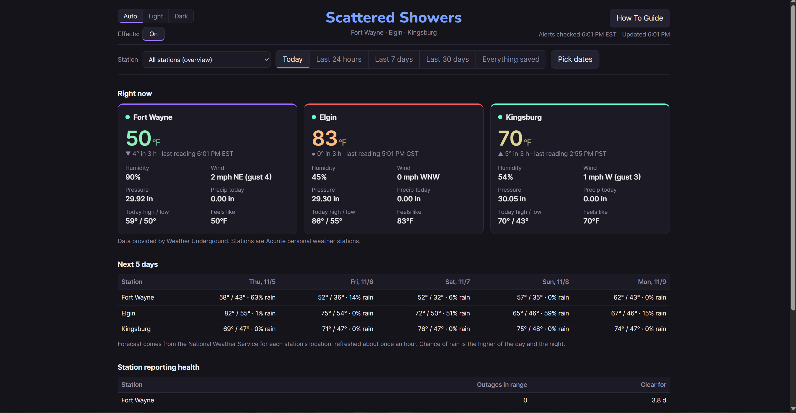
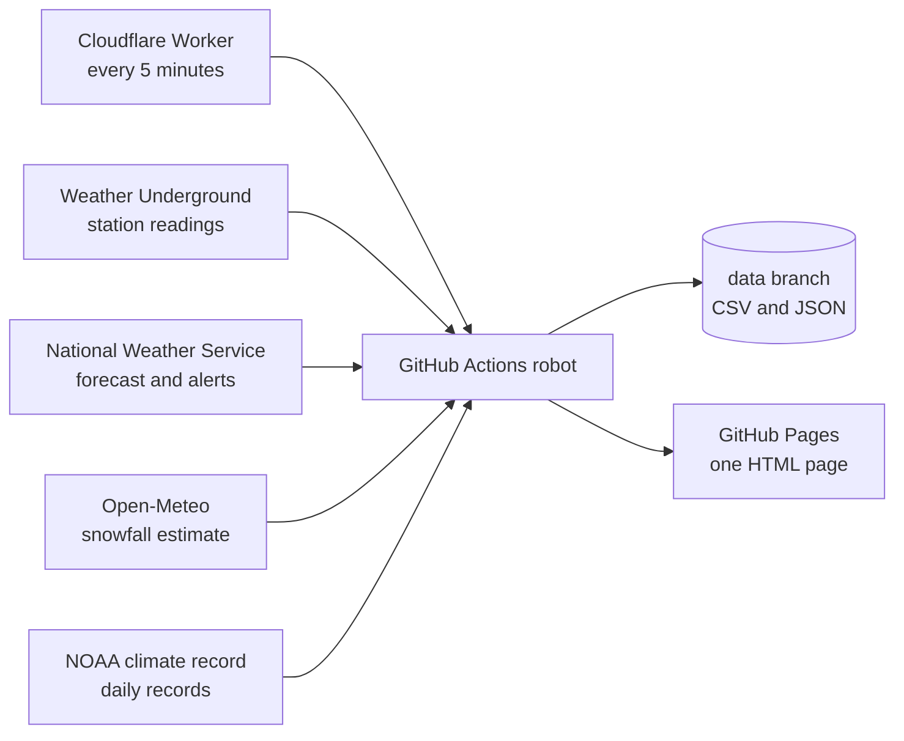

# Scattered Showers

A homemade weather dashboard for three backyard weather stations. One HTML page, updated every 5 minutes by a robot, no server, no monthly bill.

**Live page: https://derrikidennis.github.io/scattered-showers/**

The stations are Acurite personal weather stations in Fort Wayne (Indiana), Elgin (Texas) and Kingsburg (California). The page works as a normal website and also installs to a phone or tablet home screen.

## What's on the page

- A card per station with current temperature, wind, humidity, pressure and rain, and a gauge view when you pick one station
- History charts, each with a Chart/Table switch if you'd rather read numbers
- A 5-day forecast for each station, plus a scrolling hourly forecast on each station's own page, both from the National Weather Service
- Time ranges from Today up to everything saved, or pick your own dates
- A station reporting health table that counts outages
- Active National Weather Service alerts for each location, colored the way the NWS colors them
- A radar map that fits each station, with a snowfall estimate for the last 72 hours
- Record highs and lows for every calendar day, from the long NOAA climate record
- Light, dark or automatic theme, plus optional rain and wind animations (the Effects button)
- A written How To Guide: [docx/Scattered_Showers_Guide.html](docx/Scattered_Showers_Guide.html)

Station history starts on 2026-10-15, when the collector first ran. Stations drop readings now and then. The page keeps track of the gaps instead of hiding them.

## How it works

One robot run does five things: fetch the readings, build the page, check the page and data for anything private, save the data, publish the page. The live reading is taken on every run. Station history comes in about every 15 minutes, forecasts and snowfall about hourly, the record highs and lows about monthly.

A few choices that look odd until you know why:

- **A Cloudflare Worker presses the button.** GitHub's own scheduler fired once in about 11 hours for this repo, so it was removed. The Worker (code in `scr/pinger_worker.js`) starts the robot every 5 minutes instead.
- **The data lives on its own `data` branch.** Every run saves a commit there, so that branch has well over a thousand commits. Keeping it away from `main` keeps the code history readable.
- **The page is one self-contained HTML file** with the data baked in. A page you leave open checks a tiny file and reloads itself when a newer build exists.
- **`main` gets an empty commit about every 12 hours.** See "Rough edges" below.

## Privacy by design

The repo is public and the stations are at people's homes, so the robot refuses to publish anything it shouldn't. Station coordinates are rounded to 3 decimals (about 100 meters). No street addresses appear anywhere. API keys live in GitHub secrets and never in a file. Before every publish, `scr/publish.py --check` scans the page and the data and stops the whole run if it finds coordinates with more than 3 decimals, street-address-looking text, an email address, or the shape of a key.

## Where the data comes from

| Source | Used for | Key needed |
|---|---|---|
| [Weather Underground](https://www.wunderground.com/) personal weather station API | Station readings | Yes |
| [National Weather Service](https://www.weather.gov/documentation/services-web-api) | Forecasts and alerts | No, but it asks callers to identify themselves |
| [Open-Meteo](https://open-meteo.com/) | Hourly snowfall estimate (a model, not a measurement) | No |
| [NOAA ACIS](https://www.rcc-acis.org/) | Record highs and lows | No |
| [Iowa Environmental Mesonet](https://mesonet.agron.iastate.edu/) | NEXRAD radar tiles | No |
| [RainViewer](https://www.rainviewer.com/) | Backup radar | No |
| [CARTO](https://carto.com/) and [OpenStreetMap](https://www.openstreetmap.org/copyright) contributors | Map background | Yes |

Bundled in `scr/vendor/` with their licenses: [Leaflet](https://leafletjs.com/) (BSD 2-Clause) for the map and [Lucide](https://lucide.dev/) (ISC) for the icons.

## What's in this repo

| Path | What it is |
|---|---|
| `scr/` | The Python scripts, the page template, the station list, fonts and the bundled libraries |
| `scr/robot.py` | One robot run, start to finish |
| `scr/stations.json` | Which stations to track |
| `docx/` | The How To Guide and its pictures |
| `pwa/` | Home screen icons and the install manifest |
| `.github/workflows/robot.yml` | The robot's instructions |

Outside this branch: the `data` branch holds the station history and the saved forecasts, and the built page is published to GitHub Pages.

The only outside Python libraries are `tzdata` and `shapely` (see `requirements.txt`). The robot runs on Python 3.13.

## Running your own copy

I haven't tried this as a fresh fork, so treat it as a map, not a tested recipe.

1. Fork the repo and put your own stations in `scr/stations.json`. Keep coordinates to 3 decimals.
2. Add three repository secrets: `WU_API_KEY`, `NWS_CONTACT` (an email or URL the NWS can reach you at) and `CARTO_KEY`.
3. In Settings, then Pages, set the source to GitHub Actions.
4. Run the "Scattered Showers robot" workflow by hand with Dry run unticked. On a brand new repo with no history, also tick "Allow empty data".
5. For the 5-minute rhythm, set up something that runs the workflow on a timer. This repo uses the Cloudflare Worker in `scr/pinger_worker.js`.

## Rough edges

**The page froze, and the robot said everything was fine.** On 2026-11-05 the live page stopped updating for 17 hours while every robot run, data save and Pages deploy reported success. All of those deploys used the same commit as their version label, and the freeze came after the 463rd. A new commit unstuck it. I don't know for sure that the label was the cause, but nothing else lined up. The workaround is that the robot now adds an empty commit to `main` when the newest one is 12 or more hours old (`bump_main` in `scr/robot.py`), which is why the commit list on `main` has a bot in it. If the page freezes again, that's the first place to look.

**These are personal weather stations.** Readings can be off, offline or in the shade of a tree. Alerts come straight from the National Weather Service, but if the sky looks bad, go to [weather.gov](https://www.weather.gov/) and not to this page.

**No license.** This is a family project, so all rights are reserved by default. If you want to reuse something, ask.

## Who made it

Built by Derrik, who doesn't have a programming background, working with Claude (Anthropic's AI assistant). Derrik decides what it should do and tests it on real devices, Claude writes most of the code, and both of them have put bugs in it.
